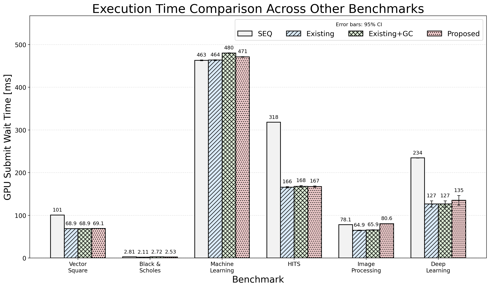
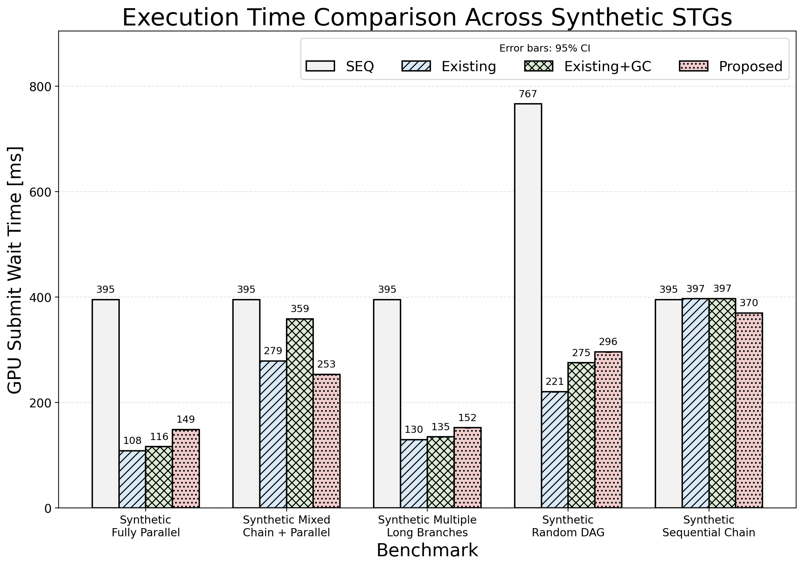
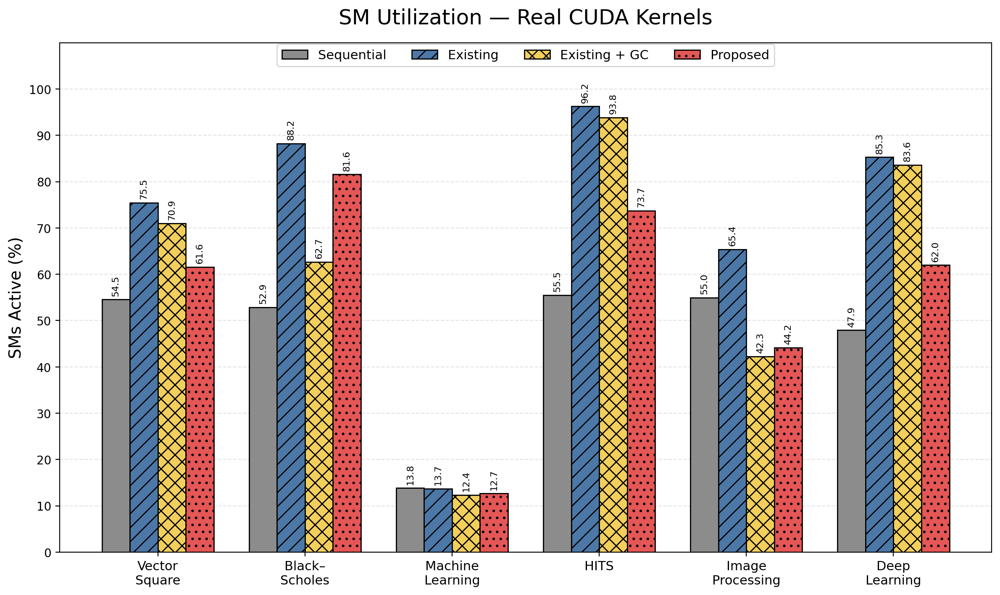
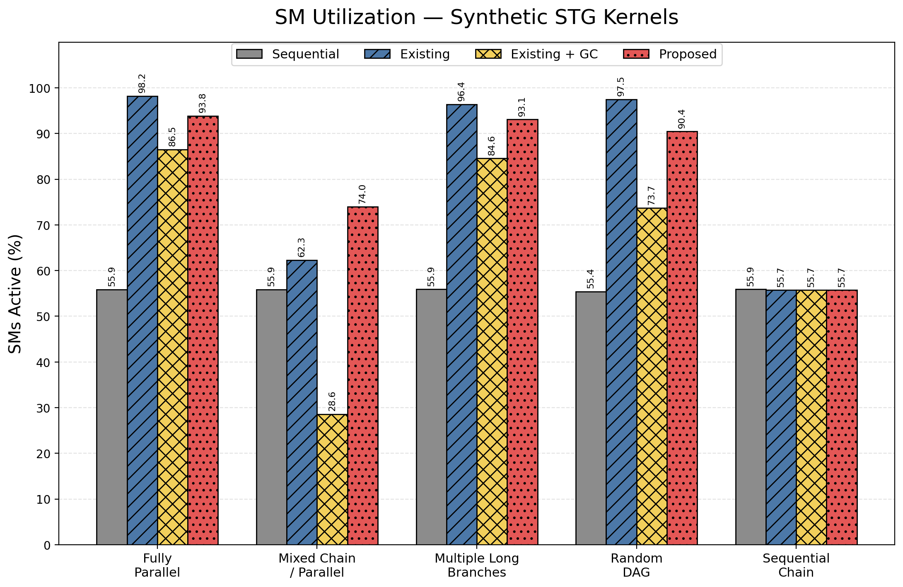

# 単一GPU向けタスクスケジューリング手法の評価

## 研究背景

生成AIをはじめとするGPU利用アプリケーションの普及に伴い、単一GPU上の計算資源を効率的に利用することが求められています。依存関係を持つタスクグラフでは、独立したタスクを複数のCUDA Streamへ配置することで並列実行でき、タスクグラフ全体の実行時間（makespan）を短縮できます。

一方、複数のCUDA Streamで実行されるタスクは、GPUのStreaming Multiprocessor（SM）を共有します。そのため、タスクの同時実行によるSM資源の競合によって個々のタスクの実行時間が変化し、重要な依存経路上のタスクが遅延すると、並列性を活用していてもmakespanが増加する可能性があります。CUDA Green Contextを利用すると、Contextごとに使用可能なSM数を制限でき、Stream間のSM資源配分を制御できます。

## 既存研究と課題

既存研究のKeSCoは、タスクの依存関係を考慮して複数のCUDA Streamへタスクを配置し、Stream間の同期を減らすことで並列実行を実現します。しかし、既存手法ではStreamごとのSM資源配分を明示的に行わず、全StreamがGPUのSMを共有します。そのため、SM資源の競合が重要タスクの実行を遅延させる可能性があります。

また、SM使用率が同程度であっても、タスクグラフの構造やSM配分の偏りによってmakespanには差が生じます。特に、重要度の高いタスクへSMを集中させるだけでは、各Streamの処理量が同程度で並列性の維持が重要なタスクグラフにおいて、SM数の少ないStreamがボトルネックになる場合があります。したがって、タスクの重要度、依存構造、Stream間の並列性、SM資源配分を同時に考慮して実行構成を選択する必要があります。

本リポジトリでは、逐次実行、既存のStream配置、既存配置へのGreen Context適用、およびタスク重要度に基づくStream配置とSM配分を行う提案手法を同一のSTGベンチマークで比較し、makespanとGPU資源利用状況の観点から評価します。

## 目的

本研究では、依存関係を持つStatic Task Graph（STG）を対象に、タスクの重要度を考慮したCUDA Streamへの配置と、StreamごとのSM資源配分を組み合わせる静的スケジューリング手法を評価します。重要度の高いタスクへ必要なSMを確保して依存経路の遅延を抑えながら、残りのSMで独立タスクの並列実行を維持し、STG全体のmakespanを短縮できるかを検証します。

## 結果

以下は、本リポジトリに保存されている最新の測定結果です。実行時間は各ベンチマークと手法の組合せを33回実行し、先頭3回のウォームアップを除いた30回の平均を示します。エラーバーは平均の95%信頼区間です。

### 実行時間

#### 実アプリケーション由来ベンチマーク



#### 合成STG



実アプリケーション由来ベンチマークでは、今回の測定条件において提案手法は既存手法を上回りませんでした。一方、合成STGでは、提案手法がMixed Chain + Parallelで253.35 ms、Sequential Chainで370.06 msとなり、4手法中で最短でした。Mixed Chain + Parallelでは既存手法の278.72 msに対して約9.1%、Sequential Chainでは既存手法の396.91 msに対して約6.8%短縮しています。Fully Parallel、Multiple Long Branches、Random DAGでは既存手法が最短であり、タスクグラフの構造によって有効なStream配置とSM配分が異なることが分かります。

### SM使用率

SM使用率は、Nsight Systemsで取得した`SMs Active [%]`です。初期化カーネルを除き、対象タスクの最初のCUDAカーネル開始から最後の終了までを測定区間とし、その区間内のサンプル平均を示します。

#### 実アプリケーション由来ベンチマーク



#### 合成STG



合成STGのMixed Chain + Parallelでは、提案手法のSM使用率は74.0%であり、Existing + GCの28.6%を上回ると同時に、実行時間も短縮しました。また、Fully Parallel、Multiple Long Branches、Random DAGでも提案手法のSM使用率は90%以上ですが、実行時間は既存手法より長くなっています。この結果は、SM使用率の高さだけではmakespanを説明できず、重要な依存経路の進行、Stream間の負荷分散、SM配分を合わせて評価する必要があることを示しています。

元データは`results/benchmark_evaluation/latest-all/all_results.csv`と`results/benchmark_evaluation/latest-sm-active/sm_active_results.csv`にあります。これらの結果と図は評価スクリプトを再実行すると更新されます。

## 比較手法

次の4手法を同じベンチマーク入力で比較します。

| フォルダ | 手法 | 概要 |
|---|---|---|
| `sequential_method/` | Sequential | 全タスクを逐次実行する基準手法 |
| `existing_method/` | Existing | bottom levelを用いて複数の通常CUDA Streamへ配置 |
| `existing_method_green_context/` | Existing + GC | Existingと同じ配置にGreen Contextの均等SM配分を適用 |
| `proposed_method/` | Proposed | タスク重要度による配置と、固定配置に対するSM配分探索を実施 |

## 使用したベンチマーク

評価には、実アプリケーションをもとにした6種類のベンチマークと、タスクグラフの構造を制御した5種類の合成STGを用います。実アプリケーション由来のベンチマークでは実際の処理に近いタスク構成を、合成STGでは並列度や依存関係の違いがスケジューリング性能に与える影響を評価します。

### 実アプリケーション由来

| フォルダ | ベンチマーク |
|---|---|
| `KESCO/BENCHMARK_vector_square/` | Vector Square |
| `KESCO/BENCHMARK_black_scholes/` | Black & Scholes |
| `KESCO/BENCHMARK_machine_learning/` | Machine Learning |
| `KESCO/BENCHMARK_hits/` | HITS |
| `KESCO/BENCHMARK_image_processing/` | Image Processing |
| `KESCO/BENCHMARK_deep_learning/` | Deep Learning |

### 合成タスクグラフ

| フォルダ | 特徴 |
|---|---|
| `STG/BENCHMARK_synthetic_fully_parallel/` | 多数の独立タスクを持つ完全並列型 |
| `STG/BENCHMARK_synthetic_mixed_chain_parallel/` | 長い依存チェーンと並列タスクが混在 |
| `STG/BENCHMARK_synthetic_multiple_long_branches/` | 複数の長い依存経路を持つ |
| `STG/BENCHMARK_synthetic_random_dag/` | 依存関係と処理時間が不均一 |
| `STG/BENCHMARK_synthetic_sequential_chain/` | ほぼ逐次的な依存構造 |

以上の実行可能な11種類を4手法で評価し、手法間の実行時間を比較します。Micro-1とMicro-2は公開資料に元のDAGが含まれておらず、再現可能な入力として利用できないため、`KESCO/BENCHMARK_micro_1/unavailable.md`と`KESCO/BENCHMARK_micro_2/unavailable.md`に理由を記録し、自動評価対象から除外しています。

## 評価の実行方法

### 全ベンチマークを一括評価

一括評価コードは`benchmarks/`直下にあります。

```bash
cd /home/kobayashi/main/master_study/benchmarks
./run_all_benchmarks.sh
```

11個の実行可能なベンチマークを4手法で評価し、44組の結果を1つの統合CSVへまとめます。比較グラフは、合成STGとその他のベンチマークに分けて出力します。

既定では各組合せを33回実行し、先頭3回をウォームアップとして除外します。残り30サンプルから平均・中央値・標準偏差・95%信頼区間を集計します。実行回数は環境変数で変更できます。

```bash
RUNS=20 WARMUP_RUNS=5 ./run_all_benchmarks.sh
```

短時間の動作確認例：

```bash
RUNS=2 WARMUP_RUNS=1 ./run_all_benchmarks.sh
```

### 1つのベンチマークを評価

`KESCO/`と`STG/`以下の各`BENCHMARK_.../`フォルダに、そのベンチマークを4手法で評価する`run_evaluation.sh`があります。

例としてVector Squareを評価する場合：

```bash
cd /home/kobayashi/main/master_study/benchmarks/KESCO/BENCHMARK_vector_square
./run_evaluation.sh
```

HITSを評価する場合：

```bash
cd /home/kobayashi/main/master_study/benchmarks/KESCO/BENCHMARK_hits
RUNS=20 WARMUP_RUNS=5 ./run_evaluation.sh
```

どのベンチマークも同じ方法で実行できます。

```text
KESCO/ または STG/
└── BENCHMARK_<ベンチマーク名>/
    ├── <ベンチマーク名>.stg
    └── run_evaluation.sh
```

### 評価結果の出力先

最新の比較CSVとグラフは、毎回同じ名前で次のフォルダへ出力されます。

```text
/home/kobayashi/main/master_study/results/method_comparison_figures/
├── RESULT_stg/                           # benchmarks/STG/ の結果
│   ├── all_stg_results.csv
│   ├── all_stg_execution_time_comparison.png
│   └── <STG名>_execution_time_comparison.png
└── result_BENCHMARK/                    # その他のベンチマーク結果
    ├── all_benchmark_results.csv
    ├── all_benchmark_execution_time_comparison.png
    └── <ベンチマーク名>_execution_time_comparison.png
```

一括評価の比較グラフは、毎回次の2ファイルを更新します。

```text
/home/kobayashi/main/master_study/results/method_comparison_figures/RESULT_stg/all_stg_execution_time_comparison.png
/home/kobayashi/main/master_study/results/method_comparison_figures/result_BENCHMARK/all_benchmark_execution_time_comparison.png
```

最新のCSVとログは次のフォルダへ保存され、次回実行時に同じ場所を更新します。

```text
/home/kobayashi/main/master_study/results/benchmark_evaluation/
```

一括評価の出力：

```text
latest-all/
├── sequential_method/                   # CSVと実行ログ
├── existing_method/
├── existing_method_green_context/
├── proposed_method/
└── all_results.csv                      # 11ベンチマーク×4手法
```

個別評価の出力：

```text
latest-<ベンチマーク名>/
├── sequential_method/
├── existing_method/
├── existing_method_green_context/
├── proposed_method/
├── all_results.csv                      # 1ベンチマーク×4手法
└── <ベンチマーク名>_method_comparison.png
```

## ディレクトリ構成

```text
master_study/
├── sequential_method/                   # Sequentialのアルゴリズム
├── existing_method/                     # Existingのアルゴリズム
├── existing_method_green_context/       # Existing + GCのアルゴリズム
├── proposed_method/                     # Proposedのアルゴリズム
├── benchmarks/
│   ├── run_all_benchmarks.sh            # 全ベンチマーク一括評価
│   ├── KESCO/                            # KESCO由来ベンチマーク
│   │   ├── BENCHMARK_vector_square/
│   │   │   ├── vector_square.stg
│   │   │   └── run_evaluation.sh
│   │   ├── BENCHMARK_black_scholes/
│   │   ├── BENCHMARK_machine_learning/
│   │   ├── BENCHMARK_hits/
│   │   ├── BENCHMARK_image_processing/
│   │   ├── BENCHMARK_deep_learning/
│   │   ├── BENCHMARK_micro_1/            # DAG未公開のため説明のみ
│   │   └── BENCHMARK_micro_2/            # DAG未公開のため説明のみ
│   ├── STG/                              # 合成STGベンチマーク
│   │   ├── BENCHMARK_synthetic_fully_parallel/
│   │   ├── BENCHMARK_synthetic_mixed_chain_parallel/
│   │   ├── BENCHMARK_synthetic_multiple_long_branches/
│   │   ├── BENCHMARK_synthetic_random_dag/
│   │   └── BENCHMARK_synthetic_sequential_chain/
│   ├── benchmark_evaluation/             # 共通評価処理
│   ├── benchmark_inputs/                 # 旧パス互換リンク
│   ├── common/                           # 共通ヘッダ
│   ├── sm_scaling_benchmark/             # SMスケーリング検証
│   └── tools/                            # 補助ツール
├── results/                              # CSV・グラフ・測定結果
└── README.md
```

`benchmark_inputs/`には入力の実体を重複配置せず、以前のパスを使用するコードとの互換性を保つシンボリックリンクだけを置いています。

## 評価指標

評価コードは各実行ファイルが出力する次の値を収集します。

```text
gpu_submit_wait_ms
```

これはGPUへ処理を投入してから、対象となるGPU処理が完了するまでの時間です。ウォームアップを除いた値から、次をCSVへ保存します。

- 平均実行時間
- 最小・最大実行時間
- 中央値
- 標準偏差
- 平均の95%信頼区間
- 実行回数
- ウォームアップ回数

比較グラフの棒は平均値、エラーバーは平均の95%信頼区間を表します。

KESCO由来の6入力では、公式grCUDAベンチマークのB1/B5/B6/B7/B8/B10に対応する実CUDAカーネルとデータフローを実行します。STG由来の5入力と独自STGでは、従来のLIGHT/HEAVY合成カーネルを実行します。全手法で同じ入力・カーネル・起動条件を共有し、スケジューリング手法を比較します。詳細は`benchmarks/benchmark_evaluation/README.md`を参照してください。

## 各手法の概要

### Sequential

依存関係の順序を守りながら、全タスクを1本の実行系列で処理する基準手法です。

### Existing

1. STGを読み込み、依存グラフを構築する。
2. タスクをレベル化する。
3. 出口タスクまでの残り処理時間を表すbottom levelを計算する。
4. bottom levelが大きいreadyタスクを優先する。
5. 予測完了時刻が小さくなる通常CUDA Streamへ配置する。
6. TaskflowとCUDA Eventで依存制約を保って実行する。

使用するStream数は`min(最大レベル幅, 5)`です。全StreamがGPUのSMを共有し、Streamごとの専有SMは設けません。

### Existing + Green Context

Existingと同じタスク配置を使用します。その後、利用可能なSMをCUDA Green Contextの分割粒度に従って各Streamへ可能な限り均等に配分します。

タスク重要度に応じたSM再配分や、SM配分後のタスク再配置は行いません。

### Proposed

提案手法は次の5段階で処理します。

```text
Stage 1: タスクグラフ解析
    ↓
Stage 2: タスク重要度の計算
    ↓
Stage 3: CUDA Streamへのタスク配置
    ↓
Stage 4: SM配分と実行構成の選択
    ↓
Stage 5: Green Contextを用いたGPU実行
```

#### Stage 1：タスクグラフ解析

`01_task_graph_analysis.hpp`がSTGを読み込み、タスクID、処理時間、先行タスクを解析します。重複ID、存在しない先行タスク、循環依存も検出します。

#### Stage 2：タスク重要度

`02_task_importance.hpp`がbottom levelを計算します。

```text
BL(i) = p(i) + max(BL(j)),  j ∈ succ(i)
```

後続タスクがない場合は`max(BL(j)) = 0`です。値が大きいタスクほど、出口までの残り処理時間が長い重要タスクとして扱います。

#### Stage 3：Stream配置

`03_stream_scheduling.hpp`がready集合からbottom level最大のタスクを選びます。各Streamについて依存完了後の最初の空き区間を調べ、予測完了時刻が最小になるStreamへ配置します。

```text
EFT(i,s) = EST(i,s) + p(i)
```

この段階ではSM数を使用せず、タスク配置とSM配分を分離します。

#### Stage 4：SM配分

`04_execution_configuration_selection.hpp`がStage 3の配置を固定したまま、各Streamの処理量へSM数を反映して予測makespanを評価します。

```text
W_s(M_s) = Σ p_hat(i,s)(M_s)
C_max(M) = max(W_s(M_s))
```

既定の複数Stream構成では、各Streamに最低8 SMを与え、8 SM単位で配分候補を探索します。1～5 Streamの候補から予測makespanが最小の構成を選び、同値の場合はStream数が少ない構成を優先します。

#### Stage 5：GPU実行

`05_green_context_execution.cuh`がStream 0をprimary context上の通常Stream、Stream 1以降をGreen Context上のStreamとして作成します。TaskflowとCUDA Eventで依存関係を保ち、処理完了後にContext、Stream、Event、GPUメモリを解放します。

## Proposedの主な実行オプション

| 環境変数 | 内容 |
|---|---|
| `STG_MAX_STREAMS=<N>` | 評価する最大Stream数を1～5で指定 |
| `STG_DISABLE_GC=1` | Green Contextを使用せず通常Streamを使用 |
| `STG_TWO_STREAM_GC_SM=<N>` | 2 Stream構成を`[114-N, N]`へ変更 |
| `STG_STREAM_SM_COUNTS=<N0,N1,...>` | StreamごとのSM数を直接指定 |
| `STG_BACKGROUND_CHUNKS=<N>` | 背景タスクのカーネル分割数を指定 |
| `STG_DISABLE_STREAM_PLOT=1` | Stream数別グラフの生成を無効化 |

## 実行環境

- GPU：NVIDIA H100 PCIe
- GPUメモリ：約80 GiB
- CPU：AMD EPYC 7313 16-Core Processor × 2
- メモリ：125 GiB
- OS：Linux
- CUDA Toolkit：13.1
- C++ / CUDA / Taskflow / CUDA Green Context

実行にはCUDA環境、Taskflow、Python 3、Matplotlib、NumPyが必要です。

## 注意事項

- `existing_method_green_context`と`proposed_method`はCUDA Green Context APIを使用します。
- GPUによってSM数、分割粒度、最小分割サイズが異なります。
- `not enough SMs for evenly divided Green Contexts`が表示された場合は、Stream数とSM配分を確認してください。
- ログに表示されるStream別SM数は割当量であり、実際のSM稼働率そのものではありません。
- Nsight Systemsで測定する`SMs Active [%]`と、Green ContextのSM割当率は異なる指標です。
