# 3. 用語：タスクとカーネル

## タスク

スケジューラが順序と実行先を決める処理単位。  
本研究では、1タスクが1つのCUDAカーネル、または1回のカーネル起動に対応する。

## CUDAカーネル

GPU上の多数のスレッドで実行される関数。  
例：`conv2d`、`gaussian_blur`、`sobel`、`concat`。

## `proc_time`

各タスクの代表処理時間。STGの重みとして、重要度計算と初期配置に利用する。

---

# 4. 用語：STG・DAG・依存関係

## DAG（Directed Acyclic Graph）

有向辺を持ち、循環しないグラフ。ノードはタスク、矢印は先行完了を要求する制約を表す。

## STG（Static Task Graph）

実行前にタスクと依存関係を固定した静的タスクグラフ。  
本研究ではtask ID、`proc_time`、先行タスクIDを入力として使用する。

## readyタスク

すべての先行タスクが完了し、実行可能になったタスク。

<span class="claim">重要：依存関係を守ることが、正しい並列実行の前提である。</span>

---

# 5. 用語：Stream・SM・Green Context

## CUDA Stream

GPUへ投入する処理の順序を管理する実行列。異なるStreamは条件が整えば同時実行される。

## SM（Streaming Multiprocessor）

CUDAカーネルを実行するGPU内の計算資源。複数Streamは同じSMを共有する。

## Green Context

実行単位が利用できるGPU資源を制限する仕組み。本研究では比較対象として扱う。

---

# 6. 実カーネルからSTGへ

```text
CUDA実装の確認
      ↓
task IDとカーネルの対応付け
      ↓
入出力バッファから依存関係を定義
      ↓
実カーネルを測定して proc_time を決定
      ↓
8〜64 SMでSM依存時間を測定
      ↓
STGを入力として実GPUで検証
```

> STGは実行トレースから自動抽出したものではない。  
> 実装上のタスク対応、データ依存関係、測定値を静的入力へ整理したものである。

---

# 7. STGと実カーネルの対応

<div class="figure-slide">

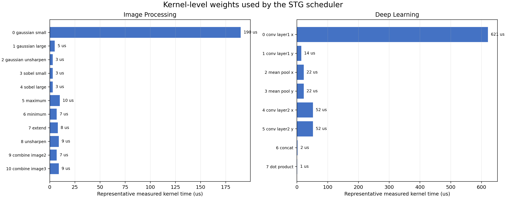

</div>

---

# 8. 図7の読み方

- STGのtask IDは、ランチャ・SMプロファイル・検証処理で共通
- `proc_time`は実カーネルの代表測定時間
- カーネル名はCUDAランチャ側のtask ID対応で管理
- 最終性能はSTG上の予測値ではなく、実GPU実行時間で評価

---

# 9. 提案手法の全体像

提案手法は、**Stream配置**と**SM配分**を分けて決定する。

```text
入力：STG、proc_time、実カーネルのSMプロファイル
  ↓
Stage 1：依存関係・level・後続関係を構築
  ↓
Stage 2：bottom levelでreadyタスクを優先順位付け
  ↓
Stage 3：Stream配置を固定し、SM配分を探索
  ↓
出力：各タスクのStreamと各StreamのSM数
```

配置を先に決めることで、Stream配置とSM配分の探索を分離する。

---

# 10. Stage 1：STG解析

各タスクについて次を構築する。

- 先行タスク集合 `P_i`
- 後続タスク集合 `S_i`
- 未完了先行数 `indegree`
- トポロジカルな `level`
- `proc_time` に基づくタスク重み

実行前に以下を検出する。

- 未知の先行タスクID
- 重複したタスクID
- 負の値や不正な入力
- level化できない循環依存

**目的：**  
不正なDAGをGPU実行前に排除し、後段の配置処理へ正しい依存関係を渡す。

---

# 11. Stage 2：タスク重要度

タスク `i` のbottom levelを、後続経路の長さとして定義する。

```text
b_i = p_i                              if S_i is empty
      p_i + max(b_j for j in S_i)      otherwise
```

- `p_i`：タスク `i` の代表処理時間
- `S_i`：タスク `i` の後続タスク集合
- `b_i`：タスク `i` から末端までの推定残り時間

ready状態のタスクから、次の順で選択する。

1. `b_i` が大きいタスク
2. `proc_time` が大きいタスク
3. task IDが小さいタスク

---

# 12. Stage 3：Stream配置

タスク `i` をStream `s`へ置く候補を評価する。

```text
r_i = max(f_j for j in P_i)
f(i, s) = e(i, s) + p_i
```

- `r_i`：先行タスク完了後のready時刻
- `e(i, s)`：Stream `s`の既配置区間を考慮した開始時刻
- `f(i, s)`：配置候補の終了時刻

各readyタスクを、**予測終了時刻が最小となるStream**へ配置する。

この段階では、まだSM配分を変更しない。

---

# 13. Stage 4：実測SMモデル

各実カーネルを、固定条件でSM数別に測定する。

```text
SM数：8, 16, 24, 32, 40, 48, 56, 64

g_i(x) = task i の x SMにおける測定時間
p_hat_i(x) = g_i(x)
```

- 測定点の間は線形補間
- 64 SMを超える候補は64 SMの値で飽和
- タスクごとに異なるSM依存性を保持

したがって、SM配分は一様な「タスク数分割」ではなく、実カーネルの測定値に基づく。ただし、測定値に基づく非均等配分が、均等配分を常に上回るわけではない。

---

# 14. SM配分の目的

Stream配置 `sigma` を固定し、Stream `s`の予測負荷を計算する。

```text
L_s(x, sigma)
  = sum(p_hat_i(x_s) for tasks i with sigma(i) = s)

C_hat(x, sigma)
  = max over streams s of L_s(x, sigma)
```

SM配分候補 `x` は、`C_hat`が小さくなるように選ぶ。

ただし、`C_hat`は次を完全には表現しない。

- 依存関係による待ち時間
- 同時実行時の性能変化
- カーネル投入・同期コスト
- Green Contextの生成・解放コスト

最終評価には、実GPUの`gpu_kernel_ms`を用いる。

<span class="claim">今回の検証上の位置付け：</span>  
SM配分は有効性を検証する候補機構であり、導入自体を正当化する前提ではない。

---

# 15. 構造指標と解釈

```text
T >= max(W / M, CP)
```

- `W`：タスク処理量の総和
- `M`：利用可能なSM数
- `CP`：クリティカルパス長

これは、処理量がSM数に比例して分散できると仮定した**理想化モデル**である。

実カーネルでは性能が非線形に変化するため、厳密なGPU時間の下界ではない。  
Stream追加の効果や、DAGに含まれる並列化余地を説明する構造指標として用いる。

---

# 16. 実験設計

## 比較方式

| 方式 | 内容 |
|---|---|
| Sequential | 依存順に逐次実行 |
| Existing | 既存のStream配置 |
| Existing + GC | 既存配置 + Green Context |
| Proposed | 重要度配置 + 実測SM配分 |

## 測定条件

- 合成STG：5種類
- KESCO由来アプリ：6種類
- 各条件33回
- 最初の3回をウォームアップとして除外
- 残り30回の平均、標準偏差、中央値、95% CI
- 実アプリ22/24条件で数値検証PASS（HITSのExisting/ProposedはFAIL）

---

# 16-A. ベンチマーク問題のDAG（1/2）

<div class="dag-grid">

<div class="dag-card">Vector Square
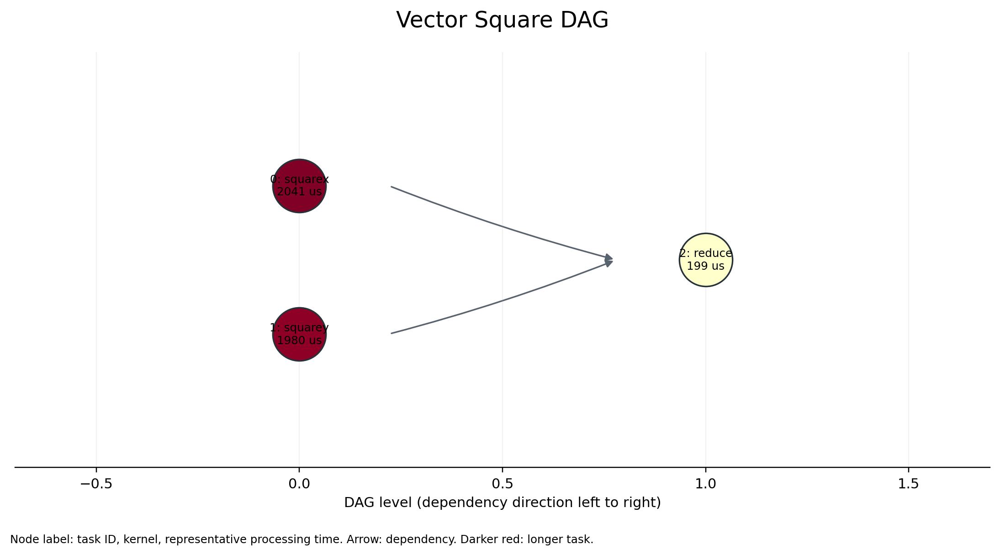
</div>

<div class="dag-card">Black–Scholes
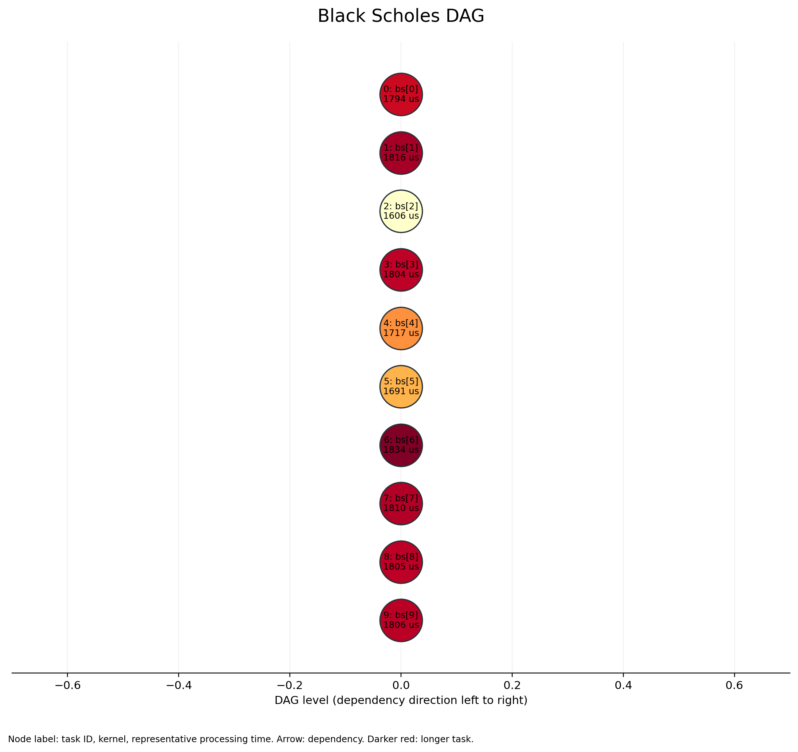
</div>

<div class="dag-card">Machine Learning
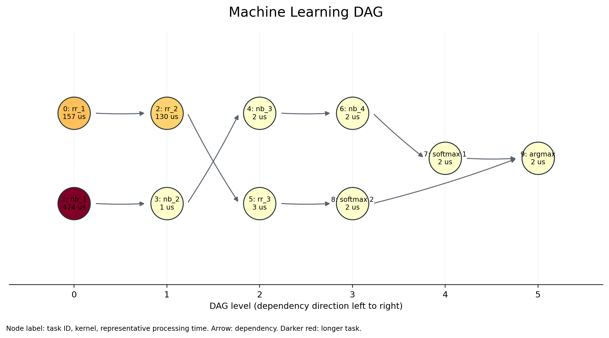
</div>

</div>

---

# 16-B. ベンチマーク問題のDAG（2/2）

<div class="dag-grid">

<div class="dag-card">HITS
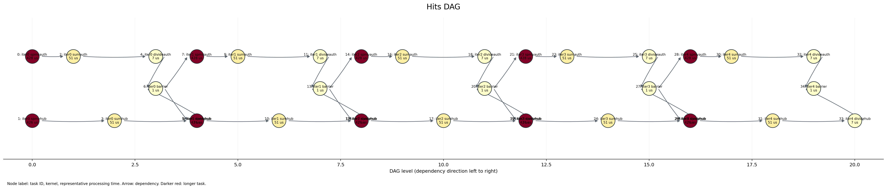
</div>

<div class="dag-card">Image Processing
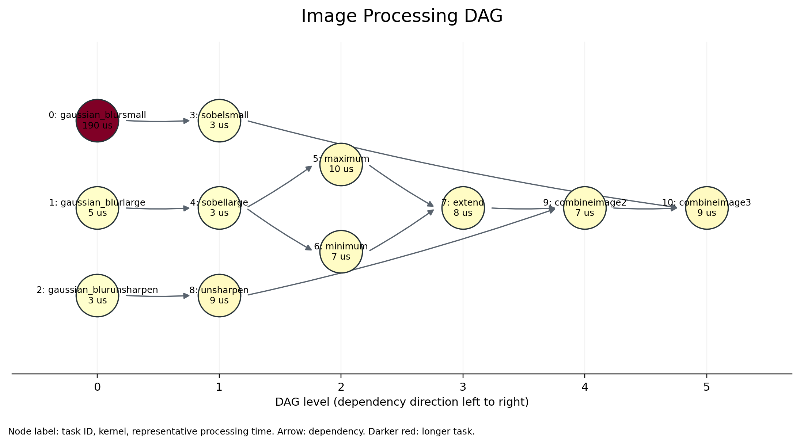
</div>

<div class="dag-card">Deep Learning
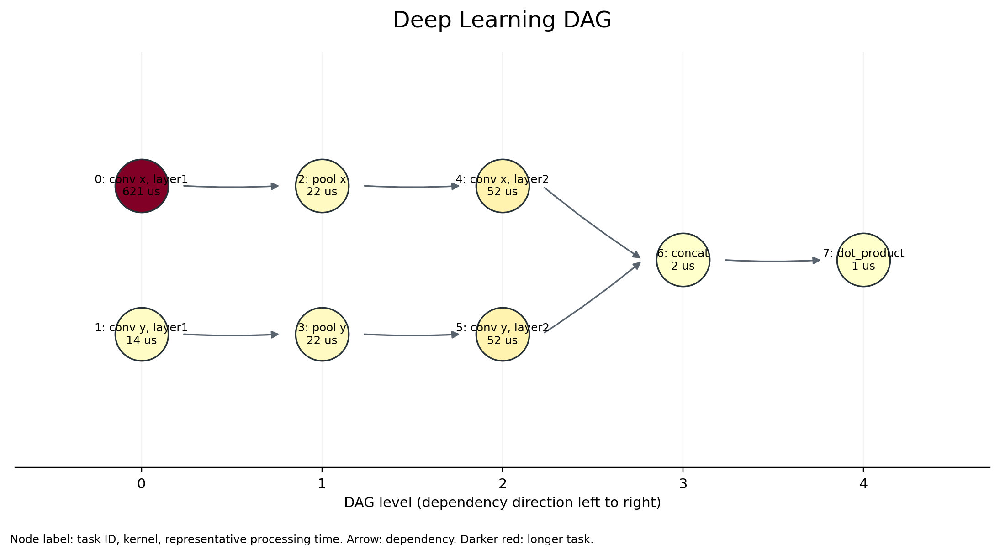
</div>

</div>

---

# 17. 合成STG：実行時間

<div class="figure-slide">

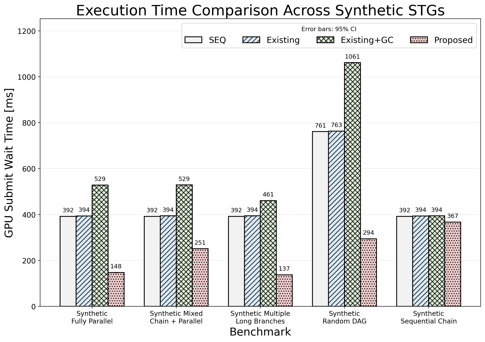

</div>

---

# 18. 合成STGの読み方

観察結果：

- 5種類すべてでProposedが最短
- Fully ParallelでもProposedが147.55 msで最短
- Existing + GCは全グラフで最長またはそれに近い

<span class="claim">解釈：</span>  
合成STGでは、今回の入力・GPU・実装条件においてProposedが有効だった。ただし、実アプリケーションでは同じ傾向が再現していないため、合成STGだけで一般性を主張しない。

---

# 19. 合成STG：全結果

| グラフ | Sequential | Existing | Existing + GC | Proposed |
|---|---:|---:|---:|---:|
| Fully Parallel | 392.29 | 394.12 | 528.62 | <span class="best">147.55</span> |
| Mixed Chain + Parallel | 392.33 | 394.27 | 528.85 | <span class="best">251.30</span> |
| Multiple Long Branches | 392.27 | 394.24 | 461.02 | <span class="best">137.47</span> |
| Random DAG | 761.23 | 763.33 | 1061.25 | <span class="best">294.04</span> |
| Sequential Chain | 392.30 | 394.06 | 394.44 | <span class="best">367.33</span> |

単位：ms。各値は平均実行時間。

<span class="claim">赤字：各グラフで最短の方式。</span>

---

# 20. 実アプリケーション：4方式比較

<div class="figure-slide">

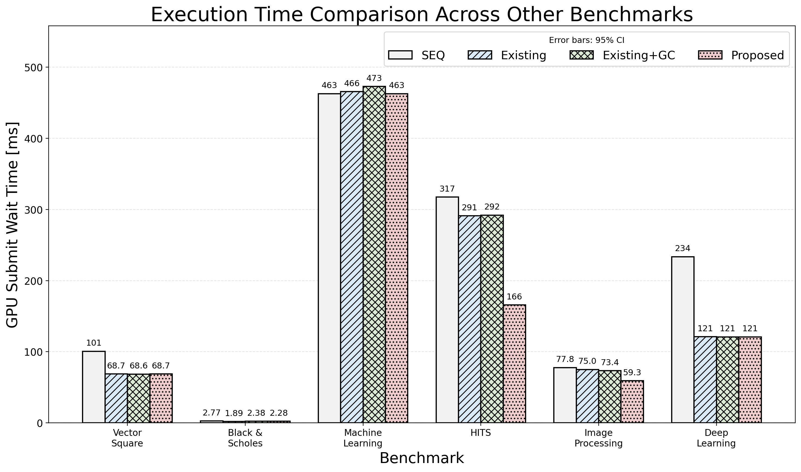

</div>

---

# 21. 実アプリケーションの読み方

主な結果：

| ベンチマーク | 最短方式 | 時間 |
|---|---|---:|
| image_processing | Proposed | 64.32 ms |
| deep_learning | Existing | 128.58 ms |
| black_scholes | Existing | 1.83 ms |
| hits | 除外（検証FAIL） | — |

<span class="claim">重要な点：</span>  
提案方式は、6アプリケーションすべてで最短ではない。

---

# 22. 実アプリケーション：全結果（gpu_kernel_ms）

| ベンチマーク | Sequential | Existing | Existing + GC | Proposed |
|---|---:|---:|---:|---:|
| vector_square | 100.63 | <span class="best">68.67</span> | 68.69 | 68.70 |
| black_scholes | 2.77 | <span class="best">1.83</span> | 2.39 | 2.18 |
| machine_learning | <span class="best">460.50</span> | 461.37 | 475.77 | 460.65 |
| hits | 317.48* | 291.93* | 294.28 | 167.57* |
| image_processing | 77.88 | 71.11 | 72.58 | <span class="best">64.32</span> |
| deep_learning | 233.17 | <span class="best">128.58</span> | 133.79 | 131.24 |

単位：ms。各値は平均実行時間。

<span class="claim">赤字：数値検証PASSした条件で最短の方式。*：HITSは数値検証FAILのため、全方式の値を参考値として性能比較に使用しない。</span>

---

# 22-A. なぜ測定値が少しずれるのか

同じベンチマーク名でも、表ごとに**別の実験バッチ・比較条件**で測定している。

- 4方式比較：各方式を33回実行し、30サンプルを集計
- アブレーション：提案パイプライン内の機能だけを切り替えて再測定
- Stream数感度：Stream数を固定し、12回中10サンプルを集計
- GPUクロック、温度、Context状態、同時負荷、起動・同期ジッタでも変動する
- Black–Scholesは約2 msと短いため、数十 µsの差でも相対差が大きく見える

例：Image ProcessingのProposed 64.32 msとFull 64.36 msは、別バッチで得た近い値である。

<span class="claim">異なる表の平均値を同一試行として直接比較せず、同じ実験内の条件間差と95% CIで判断する。</span>

---

# 23. 厳密アブレーションの設計

提案パイプラインを固定し、一つの要素だけを無効化する設計である。全条件を同じCUDA Event境界で再測定した。

| 条件 | 無効化する要素 |
|---|---|
| `Full` | 重要度・Stream配置・SM配分を使用 |
| `No importance` | bottom levelによる優先順位 |
| `No SM allocation` | 非均等なSM配分 |
| `No Stream placement` | 複数Stream配置 |

この比較により、4方式比較では分離できない個別要素の寄与を確認する。

---

# 24. 厳密アブレーション：結果

<div class="figure-slide">

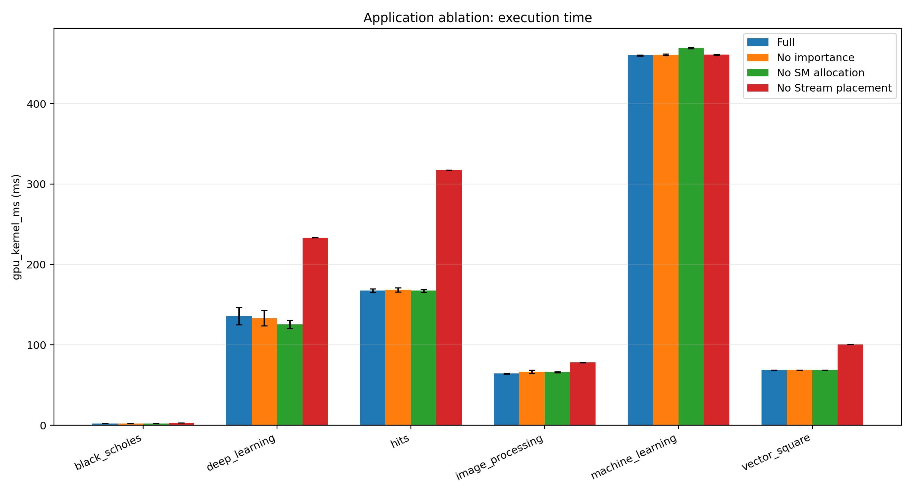

</div>

---

# 25. アブレーションの数値

### GPU makespan再測定結果

最初のタスク開始から最後のタスク終了までをCUDA Eventで測定した`gpu_kernel_ms`の平均値である。

---

# 26. アブレーション：全アプリ結果

| ベンチマーク | Full | No importance | No SM allocation | No Stream placement |
|---|---:|---:|---:|---:|
| vector_square | 68.74 | 68.73 | <span class="best">68.71</span> | 100.75 |
| black_scholes | <span class="best">2.16</span> | 2.22 | 2.18 | 2.90 |
| machine_learning | <span class="best">460.14</span> | 460.87 | 469.34 | 461.00 |
| hits | <span class="best">167.48</span> | 168.32 | 167.50 | 317.62 |
| image_processing | <span class="best">64.36</span> | 66.60 | 66.18 | 78.04 |
| deep_learning | 135.94 | 133.36 | <span class="best">125.62</span> | 233.39 |

単位：ms。各値は平均実行時間。

<span class="claim">赤字：各アプリケーションで最短のアブレーション条件。</span>

---

# 27. アブレーションから分かること

1. `No Stream placement`は全ベンチマークで遅くなった
2. `No importance`はFullより改善する場合と悪化する場合がある
3. `No SM allocation`はVector Square、Machine Learning、Image Processing、Deep LearningでFullより短かった
4. 非均等SM配分は全ケースで有効とは言えない

<span class="claim">結論：</span>  
Stream配置は主要な性能要因であり、重要度付けと非均等SM配分の効果はベンチマーク依存である。

---

# 28. Image ProcessingとBlack–ScholesのDAG比較

<div class="compare-grid">

<div class="compare-card">

## Image Processing


複数の分岐・合流を持つ

</div>

<div class="compare-card">

## Black–Scholes


10タイルが完全に独立

</div>

</div>

---

# 29. Image ProcessingとBlack–Scholesの結果比較

| ベンチマーク | Sequential | Existing | Existing + GC | Proposed |
|---|---:|---:|---:|---:|
| Image Processing | 77.88 | 71.11 | 72.58 | <span class="best">64.32</span> |
| Black–Scholes | 2.77 | <span class="best">1.83</span> | 2.39 | 2.18 |

単位：ms。4方式比較の同一実験バッチ内で比較。

- Image Processing：依存関係を考慮したStream配置に改善余地があった
- Black–Scholes：依存関係がなく、Existingでも並列性を十分利用できた
- 約2 msのBlack–Scholesでは、SM分割とスケジューリングの追加コストが相対的に大きい

<span class="claim">Proposedが効く条件は、既存方式で未利用の依存並列性があり、追加コストを回収できることである。</span>

---

# 30. 比較から分かること

## Image Processing

- 3つの根タスクと複数の分岐・合流を持つ
- readyタスクの配置順序と実行Streamに改善余地がある
- Proposedが64.32 msで最短

## Black–Scholes

- 10個の独立タイルからなる完全並列型DAG
- 複雑な重要度計算をしなくてもExistingで並列化できる
- Existingが1.83 msで最短

<span class="claim">提案方式が効くのは、DAGを考慮した配置により、既存方式より有効な重なりを作れる場合である。</span>

---

# 31. 実行時間とSM使用率

SM使用率は、makespanの代理指標として扱わない。

<div class="figure-slide">

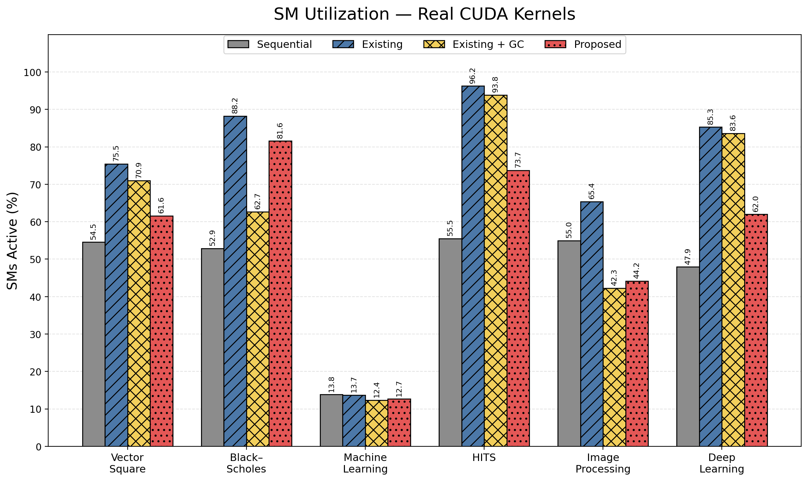

</div>

<div class="figure-slide">

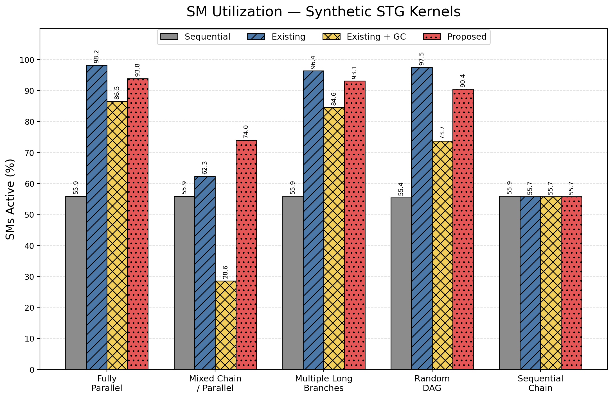

</div>

- 高いSM使用率でも、合流待ちが残ることがある
- 重要な依存経路上のタスクが遅い場合がある
- SMを分割すると、各カーネルの効率が下がる場合がある
- したがって、makespan・DAG構造・アブレーションを併記する

**評価の中心：**  
実GPUで測定した`gpu_kernel_ms`と、数値検証の結果。

---

# 32. SM使用率：全結果

| ベンチマーク | Sequential | Existing | Existing + GC | Proposed |
|---|---:|---:|---:|---:|
| vector_square | 54.55% | <span class="best">75.45%</span> | 70.95% | 61.56% |
| black_scholes | 52.89% | <span class="best">88.25%</span> | 62.65% | 81.56% |
| machine_learning | <span class="best">13.84%</span> | 13.70% | 12.36% | 12.66% |
| hits | 42.31% | 72.43% | <span class="best">72.80%</span> | 67.91% |
| image_processing | 54.96% | <span class="best">65.37%</span> | 42.28% | 44.15% |
| deep_learning | 47.92% | <span class="best">85.30%</span> | 83.62% | 61.97% |

SM使用率が高い方式が、必ずしも最短時間になるわけではない。

<span class="claim">赤字：各アプリケーションでSM使用率が最大の方式。最大化と最短時間は一致しない。</span>

---

# 33. スケジューリングオーバーヘッド

スケジューリング計算時間とGPU実行時間を分離して測定した。

| アプリ | スケジューリング | GPU時間に対する割合 |
|---|---:|---:|
| black_scholes | 0.139 ms | 6.41% |
| deep_learning | 0.129 ms | 0.10% |
| hits | 0.210 ms | 0.12% |
| image_processing | 0.145 ms | 0.22% |
| machine_learning | 0.129 ms | 0.03% |
| vector_square | 0.120 ms | 0.17% |

短い処理ではオーバーヘッドが相対的に大きい。  
長時間実行または繰り返し実行されるSTGでは、配置結果の再利用が有効である。

---

# 34. 研究の結論

## <span class="claim">実験から言えること</span>

- 複数Streamは多くの実アプリケーションで有効
- 独立分岐が多いDAGではStream配置の効果が現れやすい
- 重要度とSM配分の追加効果は、DAGとカーネル特性に依存する
- 非均等SM配分は、均等配分や既存方式を常に上回らない
- 提案方式は条件付きで有効な二段階ヒューリスティックである

## 提案方式の位置付け

<span class="claim">すべてのケースで既存方式を上回る方式ではない。</span>  
DAG構造と実カーネルの処理特性を入力として、候補構成を構成的に決定する方式である。

---

# 35. 限界と今後の課題

現在の実験範囲では、以下は未検証である。

- 異なるGPUでの再現性
- 異なる入力サイズでのSMモデルの妥当性
- 全サイズ・全seedでの合成STG評価
- 小規模グラフでの厳密最適解との比較
- Streamごとの実測イベントによる合流待ち分析

したがって、現時点の主張は**単一GPU・固定入力・評価対象ベンチマークの範囲内**に限定する。

---

# 36. 最終主張

依存関係を持つGPUタスクグラフに対して、

1. 実カーネルの依存関係をSTGとして表現し、
2. bottom levelでStream配置の優先順位を決め、
3. 実測したSM数別時間モデルで資源配分を探索し、
4. 実GPU上のmakespanと数値検証で評価した。

その結果、<span class="claim">Stream並列性は多くのケースで有効</span>である一方、<span class="claim">非均等SM配分の追加効果は限定的で、標準的に導入すべきとは言えない</span>ことを確認した。

よって、本研究の貢献は「常に最速なスケジューラ」ではなく、<span class="claim">DAG構造と実カーネル特性に応じた有効条件と限界を明らかにした、実測ベースの二段階ヒューリスティック</span>である。

<span class="claim">実務的含意：</span>  
まずStream配置で並列性を引き出し、SM分割・非均等配分は、測定上の効果が確認できる場合に限定して適用する。
